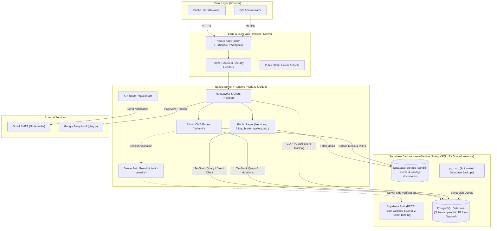

# System Architecture – Pandit Rajesh Joshi Platform

## 1. Executive Summary & Domain Overview

The **Pandit Rajesh Joshi Platform** (`pandit-rajesh-joshi`) is a full-featured web application and Content Management System (CMS) tailored for Hindu religious rituals, Vedic ceremonies, spiritual counseling, and cultural education in Ireland, the UK, and Europe.

The platform serves two primary user personas:
1. **Public Devotees & Clients**: Browse and book Vedic services (Poojas, Sanskars, Paaths, Consultations, Packages), read spiritual blog posts, explore educational resources in the Pandit Resource Center, view photo/video galleries, order books, make voluntary Dakshina contributions, and contact Panditji.
2. **Platform Administrator (Pandit Rajesh Joshi / Admin)**: Manage dynamic website content, services, packages, samagri download files, blogs, books, charity programs, testimonials, media galleries, custom pages, site navigation menus, SEO metadata, and view privacy-preserving traffic analytics through a protected `/admin` control center.

---

## 2. High-Level System Architecture



---

## 3. Technology Stack

| Category | Technology | Version | Purpose |
| :--- | :--- | :--- | :--- |
| **Framework** | Next.js (App Router) | `16.1.0` | Server-rendered & client-rendered React architecture, SSR cookies, dynamic routes |
| **UI Library** | React | `19.0.0` | Frontend component model, modern hooks, concurrent rendering |
| **Language** | TypeScript | `~5.7.2` | Type safety across client components, Supabase schemas, and API handlers |
| **Styling** | Tailwind CSS v4, PostCSS | `4.1.11` | Utility-first responsive design, modern CSS variables theming |
| **Component Primitives** | Radix UI (`@radix-ui/*`) | `1.x - 3.x` | Accessible dialogs, dropdowns, accordions, tabs, popovers, drawers, tooltips |
| **UI Toolkit** | shadcn/ui & Lucide Icons | Latest | Reusable UI atoms (`Button`, `Card`, `Badge`, `Sidebar`, `Sonner`, `Calendar`) |
| **Database & Auth** | Supabase (`@supabase/ssr`, `@supabase/supabase-js`) | `2.86.0` | PostgreSQL 17, Row Level Security (RLS), Auth sessions via PKCE cookies |
| **Data Fetching & Cache** | TanStack React Query | `5.83.1` | Remote state caching, optimistic updates, query invalidation across hooks |
| **Rich Text Editor** | Tiptap (`@tiptap/*`) & React-Quill | `3.x` | WYSIWYG editing for blogs, dynamic content sections, and resource center |
| **Form Validation** | React Hook Form & Zod | `7.x / 3.x` | Form state management and schema-based runtime validation |
| **Email Transport** | Nodemailer | `8.0.1` | Transactional email forwarding via Gmail SMTP from contact inquiry forms |
| **Analytics & Viz** | Recharts, D3 | `2.15.1 / 7.9.0`| Admin analytics charting (pageviews, visitor sessions, geographic breakdown) |
| **Animation** | Framer Motion | `12.6.2` | Page transitions, hero animations, interactive card motions |
| **Security / Sanitization** | DOMPurify | `3.3.1` | XSS prevention for user-rendered HTML in rich text fields |

---

## 4. Codebase Directory Structure

```
newpanditji/
├── .github/                      # CI/CD workflows
├── plans/                        # Architectural specifications (e.g., pandit-resource-center-spec.md)
├── public/                       # Static public assets (images, icons, robots.txt, sitemap.xml)
├── scripts/                      # Data migration scripts, image uploaders, PG17 RLS scripts
├── supabase/
│   ├── config.toml               # Supabase CLI local configuration
│   ├── functions/                # Supabase edge functions (e.g., database-backup)
│   └── migrations/               # Production SQL migrations (RLS, schema updates, seed data)
├── src/
│   ├── app/                      # Next.js App Router route hierarchy
│   │   ├── [slug]/               # Dynamic pages (legal terms, privacy, custom pages)
│   │   ├── about/                # About Pandit Rajesh Joshi
│   │   ├── admin/                # Admin CMS portal (dashboard, editors, login)
│   │   │   └── login/            # Dedicated admin authentication page
│   │   ├── api/
│   │   │   └── contact/          # Server Route Handler for contact form emails
│   │   ├── blog/                 # Blog post listing
│   │   │   └── [slug]/           # Dynamic single blog post page
│   │   ├── books/                # Spiritual publications and external store links
│   │   ├── charity/              # Charitable initiatives and social work
│   │   ├── contact/              # Inquiries, WhatsApp connection, booking forms
│   │   ├── dakshina/             # Dakshina guidelines, traditional ethics, contributions
│   │   ├── gallery/              # Photos & video galleries
│   │   ├── pandit-resource-center/ # Modular educational resource center
│   │   │   └── [slug]/           # Deep resource category topics
│   │   ├── services/             # Vedic services catalog & service package breakdowns
│   │   ├── testimonials/         # Devotee reviews and experiences
│   │   ├── why-choose-us/        # Value proposition and Panditji qualifications
│   │   ├── layout.tsx            # Global root layout (SEO metadata, theme, analytics, header/footer)
│   │   └── page.tsx              # Homepage composition
│   ├── components/
│   │   ├── admin/                # Admin management interfaces (Services, Blogs, SEO, Media, etc.)
│   │   │   ├── editors/          # Rich-text and dynamic module editors
│   │   │   └── defaults/         # Fallback data structures for CMS entities
│   │   ├── pages/                # Page-level presentation components
│   │   ├── ui/                   # Reusable shadcn/Radix atomic components
│   │   ├── Header.tsx            # Site header with dynamic navigation menus
│   │   ├── Footer.tsx            # Site footer with dynamic links and legal items
│   │   ├── AnalyticsProvider.tsx # Client-side GA4 + custom Supabase analytics dispatcher
│   │   ├── ContentProtection.tsx # Client-side right-click/copy protection layer
│   │   ├── CookieConsentBanner.tsx # GDPR e-privacy consent gate
│   │   ├── WhatsAppButton.tsx    # Floating quick-chat contact CTA
│   │   └── ScrollToTopButton.tsx # Smooth back-to-top navigation widget
│   ├── hooks/                    # Custom React Query and data-fetching hooks (e.g., useServices)
│   ├── lib/
│   │   ├── analytics-tracker.ts  # In-house session and pageview tracking logic
│   │   ├── analytics-utils.ts    # GDPR cookie consent verification and helper functions
│   │   ├── auth-guard.ts         # Server-side auth guard for API route handlers
│   │   ├── constants.ts          # Static service categories and system constants
│   │   ├── storage.ts            # Supabase Storage client helpers for uploading media/files
│   │   ├── supabase.ts           # Browser Supabase client (PKCE, SSR cookie sync)
│   │   ├── supabase-server.ts    # Server-side & Middleware Supabase clients
│   │   ├── types.ts              # Global TypeScript domain interfaces and database rows
│   │   └── utils.ts              # Tailwind `cn()` class merger utility
│   ├── services/
│   │   └── auth.ts               # Admin authentication service state and login/logout handlers
│   ├── styles/                   # CSS stylesheets, variables, theme tokens
│   └── utils/                    # Sanitization (DOMPurify), SEO schema generators, image optimization
├── middleware.ts.disabled        # Server-side edge protection (archived note on Vercel deployment)
├── next.config.js                # Next.js headers, image remote patterns, cache control
├── package.json                  # NPM dependencies and run scripts
└── tsconfig.json                 # TypeScript compiler configuration
```

---

## 5. Data Flow & State Management

### 5.1 Public Read Flow (Stale-While-Revalidate with TanStack Query)
1. **Initial Mount**: Next.js App Router loads the page component (e.g., `/services`).
2. **Hook Execution**: Specialized hook `useServices()` fires a TanStack `useQuery` request.
3. **Database Fetch**: Browser Supabase client queries PostgreSQL `services` table where `is_published = true`.
4. **Caching & Rehydration**: Results are cached client-side with configurable stale times (`staleTime: 5 * 60 * 1000`).
5. **Real-Time Render**: Components render cards, dynamic content sections, samagri download buttons, and FAQ accordions.

### 5.2 Admin Write & Mutation Flow
1. **User Action**: Admin modifies service details or uploads a new samagri PDF in `AdminServices.tsx`.
2. **File Upload** (if media attached): File is sent to Supabase Storage bucket (`media` or `documents`) via `src/lib/storage.ts`, generating a public CDN URL.
3. **Mutation Execution**: Mutation triggers via Supabase client, persisting the payload to PostgreSQL.
4. **Optimistic / Query Invalidation**: React Query invalidates related queries (e.g. `['services']`), refetching fresh state across the application.
5. **Feedback**: `sonner` toast alerts the administrator of success or displays actionable database error messages.

### 5.3 Contact Inquiry Flow
1. **Submission**: Devotee fills out the inquiry form on `/contact` with ritual preferences and dates.
2. **Client Validation**: Zod & React Hook Form validate required fields and email formats.
3. **API Dispatch**: Payload is POSTed to `/api/contact`.
4. **Nodemailer Transport**: Next.js server executes route handler, authenticates with Google Gmail SMTP using app credentials, and formats an HTML inquiry email directly to `panditjoshirajesh@gmail.com`.
5. **Confirmation**: Client receives JSON acknowledgement and resets form fields.

---

## 6. Authentication & Security Architecture

### 6.1 Shared Database Multi-Tenant 3-Layer Security Model
The platform operates on a shared Supabase PostgreSQL 17 instance under a dedicated PostgreSQL schema (`panditji`), guarded by an irreversible 3-layer isolation model:
1. **Layer 1: Anonymous (Unauthenticated) Isolation**:
   - The public `anon` role is strictly restricted via RLS to reading rows where `is_published = true` across all public-facing tables.
   - Public visitors may only execute `INSERT` on designated visitor tables (`contact_inquiries`, `user_cookie_consents`, `page_views`, `service_views`, `referrer_sources`, `testimonials`).
2. **Layer 2: Irreversible 1-to-1 User Project Binding**:
   - Accounts in the shared `auth.users` pool are bound to the project via `raw_app_meta_data->>'project' = 'panditji'` and role `'super_admin'` or `'admin'`.
   - Security function `panditji.is_admin()` checks both authentication and this project claim.
   - Client-side auth (`src/services/auth.ts`) and server auth guard (`src/lib/auth-guard.ts`) immediately reject any session belonging to users of other projects on the same Supabase instance.
3. **Layer 3: Database RLS Air-Gap**:
   - 100% of tables in the `panditji` schema enforce RLS requiring `panditji.is_admin()` for draft reads and mutations (`INSERT`, `UPDATE`, `DELETE`).
   - Authenticated users from foreign projects sharing the instance have 0 read or write access to draft content or CMS records.

### 6.2 Authentication Architecture & SSR Cookies
- **Supabase Auth with SSR Cookies**: Uses `@supabase/ssr` `createBrowserClient` with `flowType: 'pkce'` and `db: { schema: 'panditji' }`. Auth tokens are stored in browser cookies rather than isolated `localStorage`, enabling server-side validation.
- **Cross-Project Cookie Isolation**: `src/services/auth.ts` invokes `clearAllAuthData()` prior to login attempts, clearing leftover session cookies from sibling projects on the shared domain before authenticating.
- **Server-Side Route Protection (CWE-602 Mitigation)**:
  - `src/lib/auth-guard.ts` provides `requireAuth()` to protect backend API routes using `supabase.auth.getUser()`, validating that `user.app_metadata.project === 'panditji'`.
  - Next.js edge middleware (`middleware.ts.disabled` ready to activate) intercepts `/admin/*` requests, validating cookies before page payloads are delivered.
  - Client-side auth guard in `AdminLayout.tsx` redirects unauthenticated or foreign-project users to `/admin/login`.

### 6.3 Front-End Security & Sanitization
- **HTML Sanitization**: All rich text content originating from editors or database records passes through `DOMPurify.sanitize()` via `src/utils/sanitize.ts` before rendering with `dangerouslySetInnerHTML`.
- **Content Protection**: `ContentProtection.tsx` installs global event handlers preventing casual content theft (disabling right-click context menu, blocking `Ctrl+C`, `Ctrl+U`, `Ctrl+S`, `F12`, and image drag-saving).

---

## 7. Storage & Asset Infrastructure

1. **Air-Gapped Supabase Storage Buckets**:
   - `panditji-media`: Stores compressed photos, hero banners, gallery items, and blog thumbnails.
   - `panditji-documents`: Stores downloadable PDF samagri checklists, religious guides, and book sample chapters.
   - `panditji-videos`: Dedicated video uploads and metadata.
   - `panditji-resources`: PDFs, mantras, and cultural stotra documents for the Pandit Resource Center.
   - All buckets enforce storage RLS policies granting public read access while restricting write/delete operations strictly to users satisfying `panditji.is_admin()`.
2. **Image Optimization**:
   - Next.js Image configuration in `next.config.js` with remote wildcards (`https://**`) and unoptimized flags where direct CDN delivery from Supabase is preferred.
   - Utility `src/utils/imageOptimization.ts` handles responsive sizing, focal cropping (`image_position`), and fallback placeholder generation.

---

## 8. Deployment & Operational Architecture

- **Hosting**: Deployed on modern edge-ready platforms (Vercel / Netlify) using `next build` and Node.js runtime.
- **Cache Strategy**: Dynamic HTML caching is disabled (`Cache-Control: no-cache, no-store, must-revalidate`) via `next.config.js` to ensure real-time reflection of CMS changes without needing site rebuilds.
- **Automated Database Backups**: Supabase PostgreSQL uses scheduled `pg_cron` jobs invoking `supabase/functions/database-backup` edge functions to preserve site data and historical revisions.
- **Migration & Operational Tooling**:
  - `npm run migrate:shared [table_or_group]`: High-performance data migrator from standalone instance to shared schema `panditji`, featuring URL remapping (`media/` -> `panditji-media/`), paginated range fetching, and automated schema cache retry.
  - `npm run create:admin <email> <password>`: Canonical CLI to create/bind admin users in `auth.users`, sync `auth.identities`, set `app_metadata.project = 'panditji'`, and populate `panditji.admin_users`.
- **Environment Configuration**: Runtime and secrets are decoupled via `.env` (template in `.env.example`), separating public client credentials (`NEXT_PUBLIC_SUPABASE_*`), target schema setting (`NEXT_PUBLIC_SUPABASE_SCHEMA=panditji`), server-side SMTP secrets (`GMAIL_*`), and backend script migration keys (`TARGET_SUPABASE_KEY` / `SUPABASE_SECRET_KEY`).
